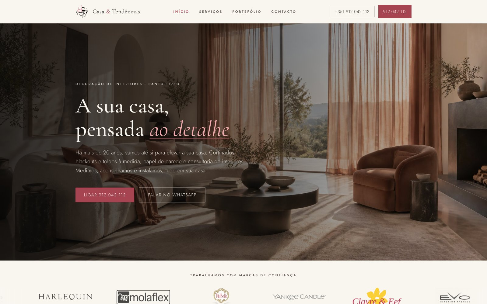
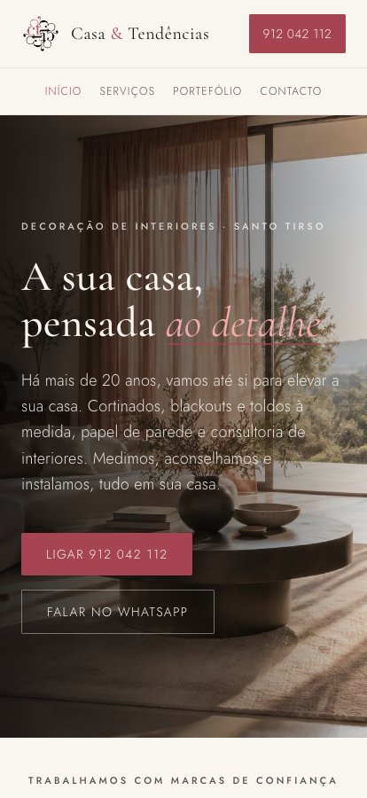
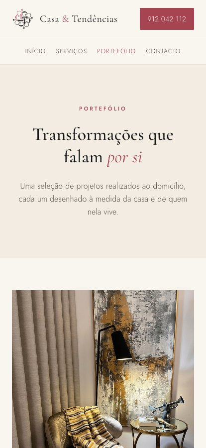
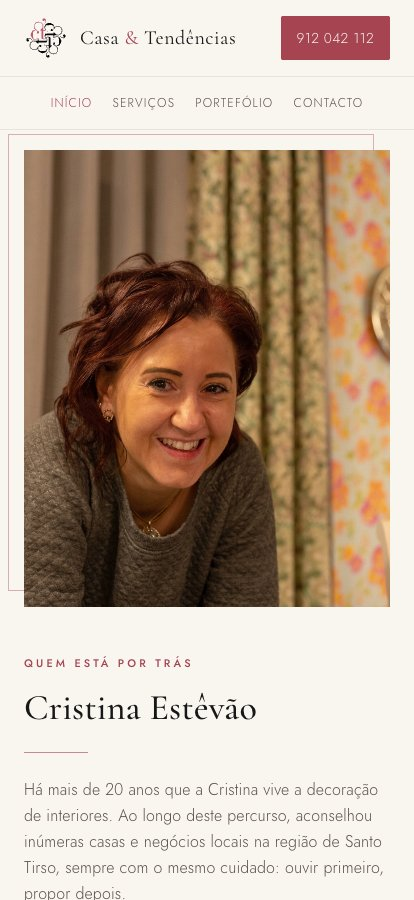
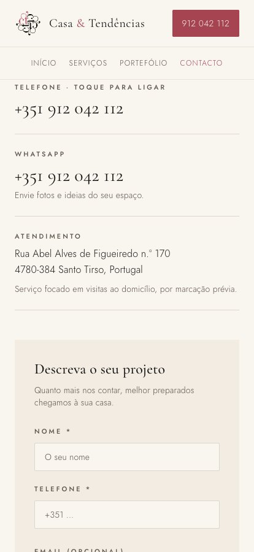

# Casa & Tendências

**DISCLAIMER: I have used AI (specifically [Lovable](https://lovable.dev)) heavily to build this website**

The website of Casa & Tendências, my mother's interior decoration business in Santo Tirso,
in the north of Portugal. She has run it for more than twenty years. The shop is currently closed
to walk-in customers: she works by appointment, at the shop or in the client's own home,
where she measures, advises and then comes back to install made-to-measure curtains, blackouts,
awnings and wallpaper.

Given this is a bookable service with no walk-ins, the page shows the standard of the projects
she has worked on, introduces the person who will come to the customer's house, and makes it
easy to book the visit by phone, by WhatsApp or with a short form. It is written in European
Portuguese.

**[Visit the site](https://casatendencias.com)**

  

## What is on the site

| Page | What it answers |
|---|---|
| **Início** | What it is and how it works. The headline and the two ways to get in touch, the brands she works with, the three services, the four steps from first call to installation, some recent projects, and a section on the store owner. |
| **Serviços** | What each service includes. Curtains, blackouts and awnings; wallpaper; and interior design advice. |
| **Portefólio** | What the work looks like. Six finished projects, and a link to the Instagram account for more. |
| **Contacto** | How to book. Phone and WhatsApp, the address with a note that visits are by appointment, and a form. |
| **The footer** | The privacy, terms and cookie pages, and the link to the official complaints book. |

  
  
  
  

## Licence

All rights reserved. The source is published to be read, not reused, and that includes the
photographs, the logo and the business's name.

Afonso Azevedo, 2026.
